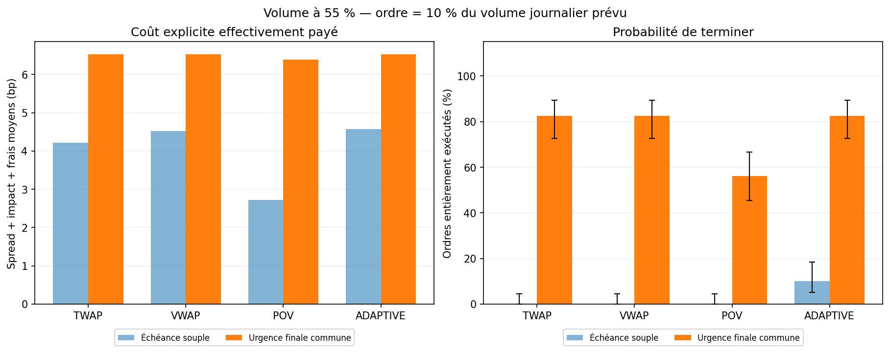

# execution-cost-analytics

[English presentation](README.md) · **Français**

**Combien coûte une meilleure probabilité de terminer un ordre lorsque les volumes sont mal prévus ?** Ce projet Python compare TWAP, VWAP, POV et un calendrier adaptatif sur des trajectoires communes, avec un protocole annoncé, des contrôles numériques et une confrontation aux données publiques.

## Résultats de référence V2

- **Aucun avantage économique établi pour ADAPTIVE contre VWAP dans le contraste principal.** Sur 80 chemins indépendants, l'économie moyenne d'implementation shortfall est de **0,109 bp**, IC bootstrap apparié 95 % **[−0,127 ; +0,371]**. La probabilité de terminer vaut **82,5 % pour les deux méthodes** ; la borne prudente ne permet pas d'établir la non-infériorité à 1 point.
- **La contrainte d'échéance a un prix mesurable.** Pour VWAP dans le scénario de volume réalisé à 55 %, ordre de 10 % du volume prévu et impact racine, l'urgence commune fait passer la complétion de **0 % à 82,5 %**, avec **2,005 bp de coût explicite moyen supplémentaire**. Il s'agit d'un contraste descriptif entre règles de fin, pas d'une préférence client universelle.
- **La confrontation historique ne confirme pas une supériorité d'ADAPTIVE.** Les prix et volumes BTC/ETH de janvier 2026 sont observés, mais le spread et l'impact restent hypothétiques. Les résultats sont séparés par actif et leurs intervalles restent descriptifs sur 17 jours consécutifs.

Ces chiffres proviennent des observations exportées, du [rapport synthétique](reports/study/RESULTATS.md), du [rapport historique](reports/real/RESULTATS.md) et du [notebook exécuté](notebooks/02_volume_uncertainty.ipynb). Ils remplacent les anciens résultats V1.



## Lancer

Depuis la racine, sous Windows PowerShell avec Python 3.11 ou 3.12 :

```powershell
python -m venv .venv
.\.venv\Scripts\python.exe -m pip install -e ".[dev]"
.\.venv\Scripts\python.exe -m execution_cost_analytics study
```

Le rapport principal est `reports/study/RESULTATS.md`. Les résultats de référence sont déjà présents ; leur lecture et l'exécution des notebooks ne nécessitent pas de télécharger les archives brutes. Sur macOS/Linux, remplacer `.\.venv\Scripts\python.exe` par `.venv/bin/python`.

Pour un essai rapide, explicitement exploratoire :

```powershell
.\.venv\Scripts\python.exe -m execution_cost_analytics study --split dev --paths 2 --bootstrap-reps 100 --output-dir outputs/exploration
```

## Comprendre et reprendre le projet

Le **[guide en français, en 10 séances](docs/GUIDE_PAS_A_PAS.md)** contient les explications Python, les exercices corrigés, la lecture des statistiques, les limites, Git et la publication.

- [Méthodologie et formules](docs/METHODOLOGIE.md)
- [Protocole fixé avant l'évaluation complète](docs/PROTOCOLE_V2.md) et [paramètres JSON](docs/PROTOCOLE_V2.json)
- [Sources et provenance](docs/SOURCES.md)
- [Notebook 01 : mécanismes et démonstration](notebooks/01_execution_cost_analysis.ipynb)
- [Notebook 02 : validation, incertitude et données publiques](notebooks/02_volume_uncertainty.ipynb)

## Ce qui change dans la V2

L'impact est facturé sur la **participation au volume local réalisé**, et non sur un volume journalier prévu. Dans un cas contrôlé à horizon, prix et participation identiques, subdiviser proportionnellement les quantités et les volumes conserve le coût. Les tests couvrent les grilles 26, 52 et 104 ainsi que l'erreur d'arrondi.

ADAPTIVE ajoute au plan VWAP un rattrapage calculé avec les quantités effectivement exécutées auparavant. Le planificateur ne reçoit aucun tableau de marché futur. POV représente une instruction de participation au flux contemporain dans une approximation agrégée.

Deux échéances sont étudiées. En mode souple, le reliquat reste visible. En mode urgence commune, les derniers `ceil(20 % × B)` créneaux autorisent toutes les politiques à demander leur solde avec le même plafond de 40 %, contre 15 % auparavant. Spread, impact et frais sont payés ; une capacité insuffisante empêche toujours de terminer.

## Expérience et décision

Les évaluations de référence portent sur des achats. L'historique de 30 séances utilise une graine distincte des 12 chemins de développement et des 80 chemins d'évaluation. La prévision est figée avant les chemins synthétiques. Cinq régimes partagent les mêmes tirages : normal, faible volume, interruption centrale, volume tardif et stress conjoint. Deux tailles d'ordre, deux modèles d'impact et deux échéances donnent **12 800 observations de stratégie**, qui ne sont pas 12 800 expériences indépendantes.

Un seul contraste principal est fixé : ADAPTIVE contre VWAP, volume à 55 %, Q = 10 % du volume prévu, urgence commune, impact racine. Les autres comparaisons sont descriptives. Les différences de coûts sont appariées par chemin ; les barres et les variantes d'un même chemin ne gonflent pas l'échantillon.

Le gain minimal illustratif est de 0,5 bp, avec des marges explicites sur le remplissage et la probabilité de terminer. Les intervalles Wilson empêchent d'interpréter un bootstrap dégénéré `[0 ; 0]` comme une certitude. Le protocole local est figé et son empreinte est conservée ; il ne constitue pas un préenregistrement indépendant.

## Données publiques

```powershell
.\.venv\Scripts\python.exe -m execution_cost_analytics fetch-public-data --symbols BTCUSDT ETHUSDT --month 2026-01 --output-dir data/public
.\.venv\Scripts\python.exe -m execution_cost_analytics real-study --input-dir data/public --output-dir reports/real
```

Les archives officielles Binance Vision sont vérifiées par SHA-256, complétude minute par minute, cohérence OHLC/VWAP et calendrier. Chaque actif utilise 14 jours initiaux puis 17 jours évalués chronologiquement, avec une prévision glissante de 14 jours. Le prix de référence d'exécution est le VWAP des transactions agrégées, **pas un midpoint bid/ask**. Décision et arrivée utilisent la première ouverture ; le reliquat utilise la dernière clôture.

Le spread de 2 bp, la volatilité de 2 % et les paramètres d'impact sont des hypothèses. Les unités entières représentent des millionièmes d'actif, pas un filtre de taille de lot d'une place. Les jours BTC et ETH ne sont pas regroupés en 34 observations indépendantes. Les intervalles historiques supposent une indépendance temporelle non vérifiée.

## Architecture

```text
src/execution_cost_analytics/
  strategies.py       calendriers entiers
  policies.py         règles causales et rattrapage
  data.py             données synthétiques et prévision
  simulation.py       liquidité réalisée et coûts locaux
  analytics.py        IS, reliquat, références et réconciliation
  study.py            protocole, scénarios et comparaisons appariées
  public_data.py      archives, qualité et provenance
  real_study.py       confrontation chronologique par actif
  study_reporting.py  tableaux, figures et interprétation
  experiment.py       démonstration pédagogique
  cli.py              commandes reproductibles
tests/                cas manuels, invariants et intégration
docs/                 guide, méthodologie, protocole, sources
notebooks/            deux analyses exécutées
reports/study/        étude synthétique de référence
reports/real/         résultats historiques attribués
```

## Vérifier

```powershell
.\.venv\Scripts\python.exe -m pytest -q
.\.venv\Scripts\python.exe -m ruff check .
.\.venv\Scripts\python.exe -m ruff format --check .
.\.venv\Scripts\python.exe scripts/execute_notebook.py
```

Le script exécute les deux notebooks avec le Python courant. Le premier reproduit la démonstration, le second recalcule les statistiques des observations exportées et lit les résultats historiques. Pour refaire les simulations intégrales, utiliser les commandes `study` et `real-study`. `scripts/refresh_reports.py` régénère uniquement les tableaux, statistiques et graphiques depuis les observations existantes.

Le [workflow GitHub Actions](.github/workflows/ci.yml) vérifie installation, code, tests et notebooks sous Python 3.11/3.12. Son statut est visible depuis la [présentation anglaise](README.md).

## Portée et licences

Les tests établissent la cohérence des calculs et de l'information disponible. Les coûts restent conditionnels à des modèles temporaires non calibrés, sans carnet, latence, impact permanent ou rétroaction sur les prix. Des observations OHLCV seules n'identifient pas l'impact causal de nos ordres.

Le code est sous [MIT](LICENSE). Les données Binance Vision et leurs résultats dérivés suivent les conditions **CC BY-NC-SA 4.0** documentées dans [les sources](docs/SOURCES.md), [la licence des rapports historiques](reports/real/LICENSE.md) et [celle des notebooks](notebooks/LICENSE.md). Les données brutes et essais personnels restent hors Git.

Le guide explique également les commandes Git et la publication du dépôt.
