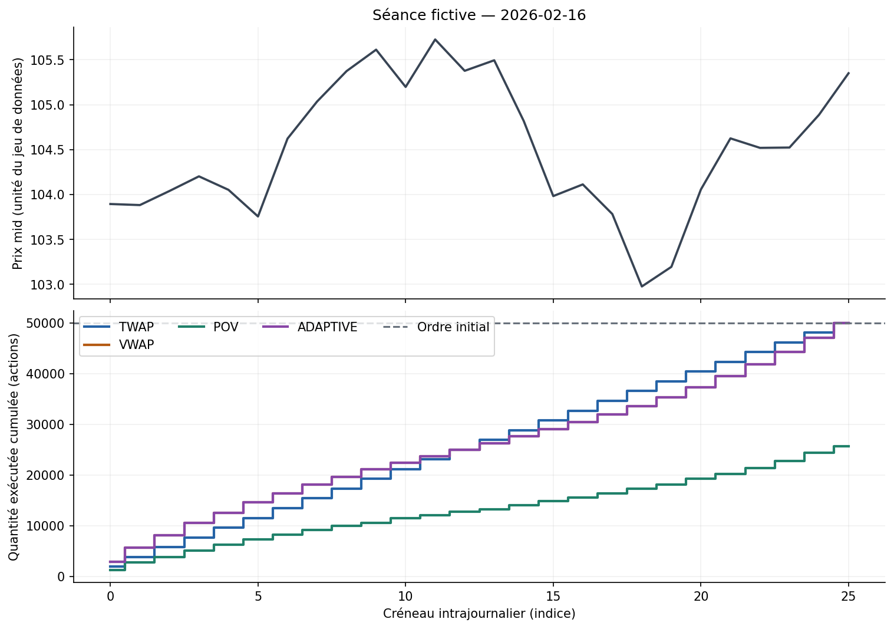
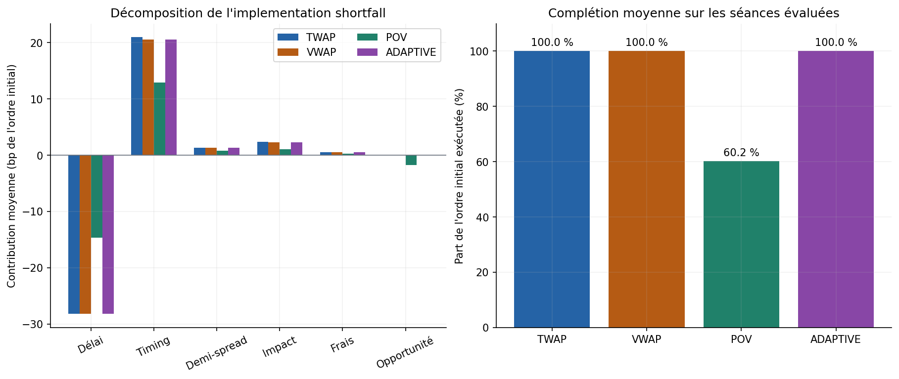
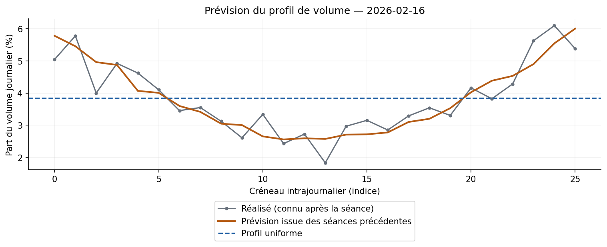
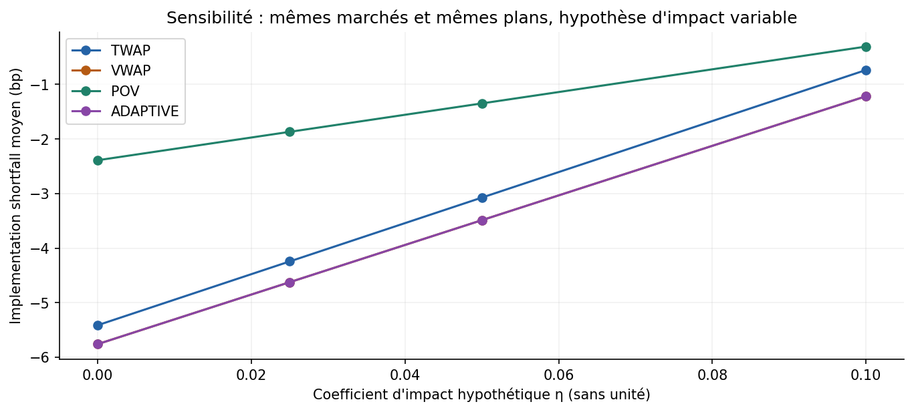

# Démonstration V2 — execution-cost-analytics

Données **synthétiques**, 26 créneaux par séance. Ordre : **50,000 actions**, côté **buy**. Les chiffres ci-dessous sont calculés par le même pipeline que le notebook exécuté `notebooks/01_execution_cost_analysis.ipynb`.

## Protocole

- Historique initial : 30 séances ; fenêtre glissante : 20 séances antérieures.
- Évaluation : du 2026-02-16 au 2026-02-27 ; aucune séance cible n'entre dans sa propre prévision.
- Décision fictive : dernier mid de la séance précédente ; arrivée : premier mid de la séance évaluée ; reliquat valorisé au dernier mid de cette séance.
- POV : 3.0% du volume externe contemporain ; plafond ordinaire : 15.0%. Mode d'échéance : `soft`. ADAPTIVE rattrape son retard avec les exécutions antérieures réellement observées.

## Comparaison descriptive

| Stratégie | Séances | Complétion moyenne | IS moyen (bp) | Écart-type entre séances (bp) |
| --- | ---: | ---: | ---: | ---: |
| TWAP | 10 | 100.0% | -3.07 | 105.09 |
| VWAP | 10 | 100.0% | -3.49 | 103.62 |
| POV | 10 | 60.2% | -1.35 | 138.07 |
| ADAPTIVE | 10 | 100.0% | -3.49 | 103.62 |

**Lecture :** un IS positif est un coût défavorable, pour un achat comme pour une vente. Il inclut la valorisation du reliquat, qui peut être négative si l'évolution des prix lui est favorable. Un faible coût sur quelques séances fictives ne prouve aucune supériorité de stratégie. L'écart-type décrit la dispersion ; ce n'est pas un intervalle de confiance.

## Prévision des volumes

Erreur absolue moyenne des parts de volume par créneau : **0.003547** pour le profil historique, contre **0.009935** pour le profil uniforme. Ces valeurs sont des fractions du volume journalier, moyennées sur les créneaux puis sur les séances ; multiplier par 100 pour les exprimer en points de pourcentage. Le générateur possède volontairement un profil en U : la comparaison teste le fonctionnement de la méthode sur ce cas construit.

## Sensibilité et contrôles

Écart absolu maximal entre l'IS direct et la somme de ses six composantes : **1.67e-09 unité monétaire du jeu de données**. Les tests vérifient aussi les achats, les ventes, le reliquat, la conservation des quantités et l'absence d'accès aux créneaux futurs dans le calendrier POV.

## Limites

Ce laboratoire utilise une simulation par barres : POV participe au flux contemporain observé dans une approximation agrégée. L'impact temporaire vaut `mid × eta × sigma × (quantité exécutée / volume local réalisé)^alpha`. Le volume prévu sert à décider et n'entre pas dans la facturation de l'impact. Cette forme reste hypothétique et non calibrée. Les prix du marché sont exogènes ; aucun carnet ni latence n'est reproduit.

Le benchmark VWAP est une moyenne pondérée des **mids** de la séance, calculée ex post, et non le VWAP officiel de transactions d'une place. La comparaison au VWAP sur des ordres partiellement exécutés doit être lue avec le taux de complétion et l'IS total.

## Retrouver les calculs

- `summary.csv` : chaque séance et chaque stratégie, six composantes et réconciliation.
- `aggregate_summary.csv` : tableau de comparaison ci-dessus.
- `fills.csv` : chaque créneau, plan, quantité exécutée, prix et frais.
- `forecast_metrics.csv` et `volume_profiles.csv` : prévisions et évaluation ex post.
- `sensitivity.csv` : scénarios η = 0 ; 0,025 ; 0,05 ; 0,1.
- `experiment.json` : paramètres et versions utilisés.

Le protocole V2, ses tests de grille et l'étude appariée sont dans `docs/PROTOCOLE_V2.md` et `reports/study/RESULTATS.md`. Le guide et les formules sont dans `docs/GUIDE_PAS_A_PAS.md` et `docs/METHODOLOGIE.md` à la racine du dépôt. Cette démonstration remplace les résultats V1 fondés sur l'ancien impact par tranche.
