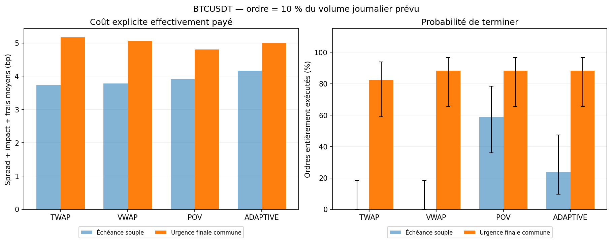
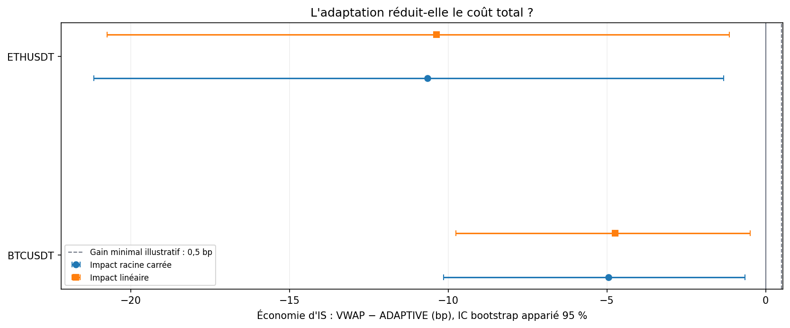
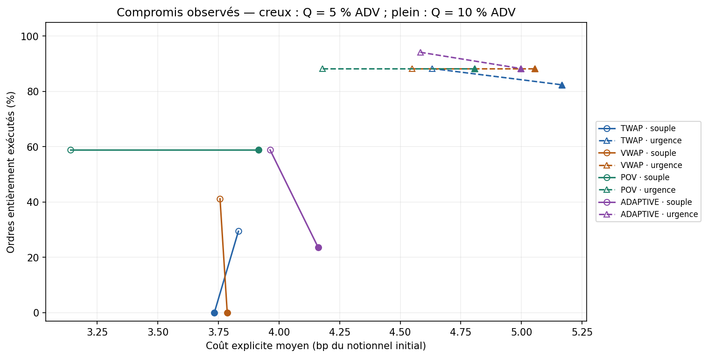

# Confrontation historique publique

Prix et volumes de transactions historiques Binance Vision, BTCUSDT et ETHUSDT en janvier 2026. Chaque actif est étudié séparément : ses journées évaluées constituent les paires. Le prix est un VWAP de transactions par barre, pas un milieu bid/ask ; spread de 2 bp et impact sont des hypothèses. Les 14 premières journées forment l'historique initial ; les 17 suivantes sont évaluées chronologiquement avec une fenêtre de 14 jours. Les choix ont été fixés avant lecture des résultats.

**Incertitude historique descriptive :** les 17 journées sont consécutives et les prévisions utilisent des fenêtres glissantes. Le bootstrap de journées et Wilson supposent une indépendance approximative non vérifiée ; leurs intervalles ne constituent pas une preuve statistique de performance historique ni une validation de l'impact.

## Question et protocole

Quel coût supplémentaire accompagne une meilleure probabilité de terminer lorsque les volumes sont mal prévus ? Le protocole décrit une étude ; il ne garantit aucun gagnant. Il est figé localement avant les expériences, sans prétendre à un préenregistrement indépendant.

Aucun contraste confirmatoire dans cette sortie. Les comparaisons sont descriptives ou exploratoires.

Le signe de l'économie est `IS_VWAP − IS_ADAPTIVE` : positif favorise ADAPTIVE. La variation de complétion est `P(terminer)_ADAPTIVE − P(terminer)_VWAP`. Les intervalles sont conditionnels au jeu de données et au modèle ; ils n'incluent pas l'incertitude sur la validité économique du simulateur.

## Comparaisons conditionnelles

| Régime / actif | Paires | Économie IS (bp) | IC bas | IC haut | Δ complétion (pp) | Borne prudente (pp) | Lecture |
| --- | --- | --- | --- | --- | --- | --- | --- |
| BTCUSDT | 17 | -4.950 | -10.138 | -0.648 | 0.000 | -31.048 | Économie utile non établie |
| ETHUSDT | 17 | -10.649 | -21.163 | -1.325 | 0.000 | -31.048 | Économie utile non établie |

Cette confrontation historique ne comporte aucun test confirmatoire. Les lignes et le modèle linéaire décrivent les résultats conditionnels et leur sensibilité ; les intervalles ne suffisent pas à établir une performance historique. Une amélioration de complétion accompagnée d'un coût plus élevé est un compromis à chiffrer ; aucun budget client ne permet ici de déclarer ce prix acceptable universellement.

## Comment juger les résultats

- Quantités entières, limites de capacité et chronologie : contrôlées par les tests.
- Réconciliation : écart absolu maximal **4.41e-08** unité monétaire.
- Grille 26 / 52 / 104 : **contrôles réussis** dans `grid_check.csv`. Même prix, même participation, quantité et volume subdivisés proportionnellement ; les arrondis sont testés séparément.
- Gain minimal illustratif : **0,5 bp**. Marge de non-infériorité de complétion : **1 point**. Écart de q95 des coûts : garde-fou **descriptif** de 2 bp, pas un test de risque établi.
- Le bootstrap peut donner un intervalle de complétion dégénéré `[0 ; 0]` en l'absence de cas discordants observés. Il ne prouve pas que la différence vraie est nulle. La décision ajoute la borne prudente `100 × (WilsonLower(candidat) − WilsonUpper(baseline))` ; les bornes Wilson restent approximatives. Voir `completion_bootstrap_degenerate` et `completion_noninferiority_bound_pp`.
- Toujours examiner `completion_probability` (ordre entièrement terminé), `mean_fill_rate` (fraction moyenne exécutée), IS et coût explicite. Ce sont des indicateurs différents.
- Le nombre de chemins est fixé dans le protocole ; aucune taille d'échantillon n'est sélectionnée pour obtenir un résultat favorable.

## Modèle et information disponible

La politique reçoit un plan ex ante et les quantités réellement exécutées auparavant. ADAPTIVE ajoute `ceil(gain × retard antérieur)` à la demande courante. Le simulateur facture ensuite l'impact selon `prix × eta × sigma × (quantité / volume local réalisé)^alpha`. La prévision n'est pas utilisée comme liquidité de facturation.

En mode souple, aucun remplissage final n'est imposé. En mode urgence commune, toutes les politiques demandent le reliquat durant les derniers `ceil(20 % × nombre de créneaux)` créneaux, avec plafond de participation 40 % au lieu de 15 %. Spread, impact et frais sont payés ; les capacités peuvent rendre l'objectif impossible. Aucun reliquat n'est acheté gratuitement au dernier prix.

Les deux exposants, 0,5 et 1, sont normalisés au même impact à 10 % de participation. Cela facilite la comparaison de forme ; aucune calibration de marché n'est revendiquée.

## Limites et reproductibilité

Les prix demeurent exogènes, sans carnet, files d'attente, latence ou impact permanent. POV est une instruction de participation au flux contemporain dans une représentation agrégée. Les modèles d'impact restent hypothétiques. Ajouter des observations historiques ne suffit pas à identifier l'effet causal de nos propres ordres.

`summary.csv` conserve chaque paire et configuration, `aggregate.csv` les moyennes et queues, `comparisons.csv` les différences appariées et intervalles, `sample_fills.csv` des traces d'exécution, `forecast_metrics.csv` les erreurs de prévision et `experiment.json` les paramètres et empreintes. Le guide se trouve dans `docs/GUIDE_PAS_A_PAS.md` à la racine du projet.

## Attribution et licence des résultats historiques

Données : **Binance Vision**. Ces tables, figures et commentaires dérivés des données sont placés sous **CC BY-NC-SA 4.0**, sous réserve des conditions Binance Vision : https://github.com/binance/binance-public-data/blob/master/TERMS_AND_CONDITIONS.md . La licence MIT du code ne couvre pas ces sorties. Les archives brutes et CSV préparés restent dans `data/`, ignoré par Git. Les URLs exactes, empreintes SHA-256 et contrôles de complétude figurent dans `experiment.json`.
