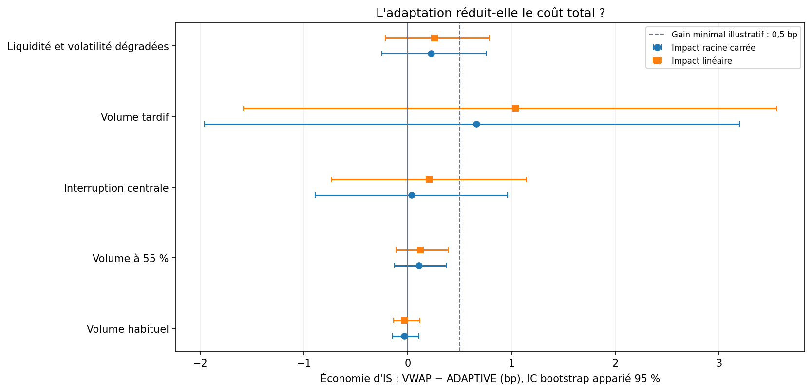
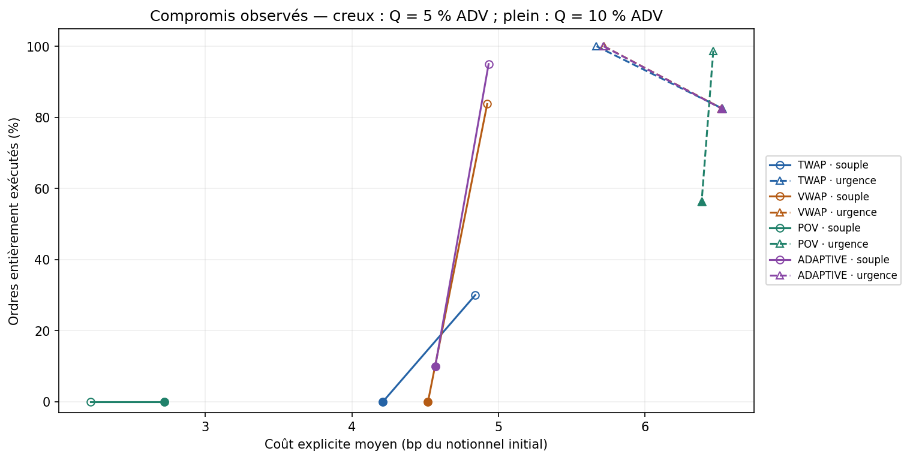

# Étude V2 : volume incertain et coût de complétion

Marchés synthétiques : mêmes trajectoires pour toutes les stratégies, cinq régimes, deux tailles d'ordre, deux modèles d'impact et deux modes d'échéance. Les graines de développement sont séparées des graines d'évaluation. L'unité de rééchantillonnage est le chemin indépendant, jamais une barre. Les scénarios et seuils sont figés dans le protocole et son empreinte.

## Question et protocole

Quel coût supplémentaire accompagne une meilleure probabilité de terminer lorsque les volumes sont mal prévus ? Le protocole décrit une étude ; il ne garantit aucun gagnant. Il est figé localement avant les expériences, sans prétendre à un préenregistrement indépendant.

Contraste principal fixé avant l'expérience : **ADAPTIVE contre VWAP**, volume réalisé réduit, ordre de 10 % du volume prévu, urgence finale commune, impact racine carrée. Économie moyenne d'IS : **0.109 bp**, IC bootstrap apparié 95 % **[-0.127 ; 0.371]**. Variation de probabilité de terminer : **+0.00 points de pourcentage**. Borne prudente de non-infériorité de complétion : **-16.54 points**, à comparer à la marge de −1 point. Lecture du protocole : **Économie utile non établie**.

Le signe de l'économie est `IS_VWAP − IS_ADAPTIVE` : positif favorise ADAPTIVE. La variation de complétion est `P(terminer)_ADAPTIVE − P(terminer)_VWAP`. Les intervalles sont conditionnels au jeu de données et au modèle ; ils n'incluent pas l'incertitude sur la validité économique du simulateur.

## Comparaisons conditionnelles

| Régime / actif | Paires | Économie IS (bp) | IC bas | IC haut | Δ complétion (pp) | Borne prudente (pp) | Lecture |
| --- | --- | --- | --- | --- | --- | --- | --- |
| normal | 80 | -0.034 | -0.144 | 0.106 | 0.000 | -4.582 | Économie utile non établie |
| low_volume | 80 | 0.109 | -0.127 | 0.371 | 0.000 | -16.537 | Économie utile non établie |
| midday_shutdown | 80 | 0.039 | -0.893 | 0.964 | 0.000 | -4.582 | Économie utile non établie |
| late_shift | 80 | 0.663 | -1.957 | 3.195 | 0.000 | -4.582 | Économie utile non établie |
| stressed | 80 | 0.227 | -0.248 | 0.755 | 0.000 | -16.537 | Économie utile non établie |

Le contraste principal est le seul test prévu comme principal. Les autres lignes et le modèle linéaire décrivent la sensibilité, sans transformer une cellule favorable en découverte confirmatoire. Une amélioration de complétion accompagnée d'un coût plus élevé est un compromis à chiffrer ; aucun budget client ne permet ici de déclarer ce prix acceptable universellement.

## Comment juger les résultats

- Quantités entières, limites de capacité et chronologie : contrôlées par les tests.
- Réconciliation : écart absolu maximal **4.42e-09** unité monétaire.
- Grille 26 / 52 / 104 : **contrôles réussis** dans `grid_check.csv`. Même prix, même participation, quantité et volume subdivisés proportionnellement ; les arrondis sont testés séparément.
- Gain minimal illustratif : **0,5 bp**. Marge de non-infériorité de complétion : **1 point**. Écart de q95 des coûts : garde-fou **descriptif** de 2 bp, pas un test de risque établi.
- Le bootstrap peut donner un intervalle de complétion dégénéré `[0 ; 0]` en l'absence de cas discordants observés. Il ne prouve pas que la différence vraie est nulle. La décision ajoute la borne prudente `100 × (WilsonLower(candidat) − WilsonUpper(baseline))` ; les bornes Wilson restent approximatives. Voir `completion_bootstrap_degenerate` et `completion_noninferiority_bound_pp`.
- Toujours examiner `completion_probability` (ordre entièrement terminé), `mean_fill_rate` (fraction moyenne exécutée), IS et coût explicite. Ce sont des indicateurs différents.
- Le nombre de chemins est fixé dans le protocole ; aucune taille d'échantillon n'est sélectionnée pour obtenir un résultat favorable.

## Modèle et information disponible

La politique reçoit un plan ex ante et les quantités réellement exécutées auparavant. ADAPTIVE ajoute `ceil(gain × retard antérieur)` à la demande courante. Le simulateur facture ensuite l'impact selon `prix × eta × sigma × (quantité / volume local réalisé)^alpha`. La prévision n'est pas utilisée comme liquidité de facturation.

En mode souple, aucun remplissage final n'est imposé. En mode urgence commune, toutes les politiques demandent le reliquat durant les derniers `ceil(20 % × nombre de créneaux)` créneaux, avec plafond de participation 40 % au lieu de 15 %. Spread, impact et frais sont payés ; les capacités peuvent rendre l'objectif impossible. Aucun reliquat n'est acheté gratuitement au dernier prix.

Les deux exposants, 0,5 et 1, sont normalisés au même impact à 10 % de participation. Cela facilite la comparaison de forme ; aucune calibration de marché n'est revendiquée.

## Limites et reproductibilité

Les prix demeurent exogènes, sans carnet, files d'attente, latence ou impact permanent. POV est une instruction de participation au flux contemporain dans une représentation agrégée. Les modèles d'impact restent hypothétiques. Ajouter des observations historiques ne suffit pas à identifier l'effet causal de nos propres ordres.

`summary.csv` conserve chaque paire et configuration, `aggregate.csv` les moyennes et queues, `comparisons.csv` les différences appariées et intervalles, `sample_fills.csv` des traces d'exécution, `forecast_metrics.csv` les erreurs de prévision et `experiment.json` les paramètres et empreintes. Le guide se trouve dans `docs/GUIDE_PAS_A_PAS.md` à la racine du projet.
